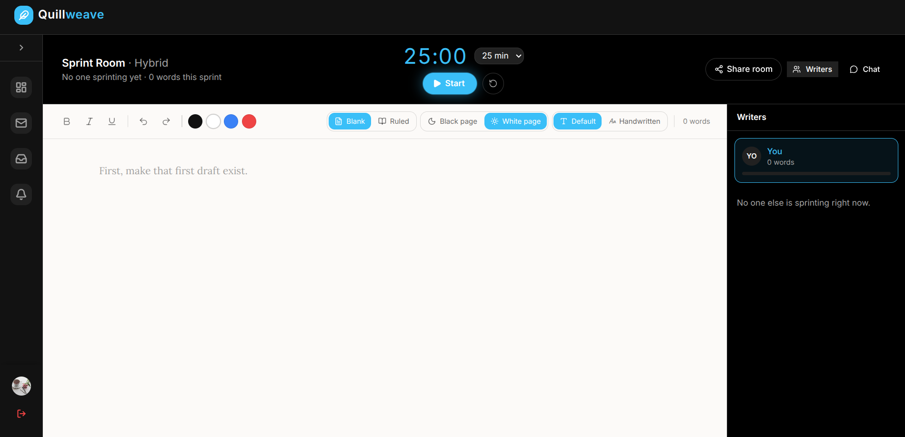
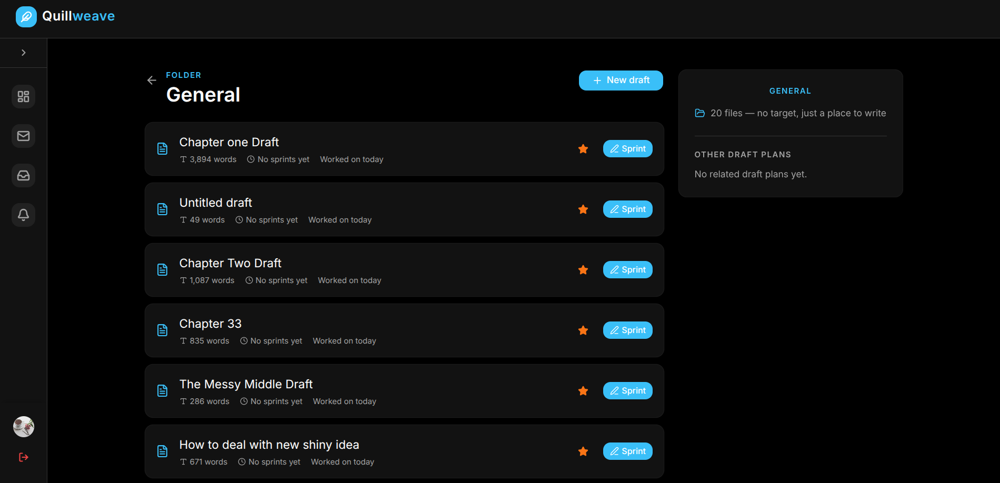
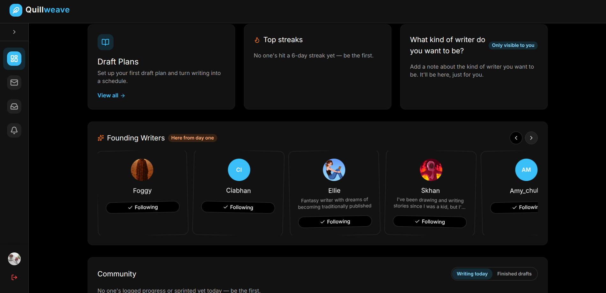

# Quillweave Frontend

Quillweave is a desktop website for writers. It helps writers set a goal for a new draft, track their daily, weekly, and overall progress, sprint in a timed writing room, and send each other encouragement and greeting cards along the way.

**Live site:** [quillweave.com.ng](https://quillweave.com.ng/) · **Backend repo:** [QuillweaveBackend](https://github.com/oyinadeolawoyin/QuillweaveBackend)

## What It Does

- **Goals and progress.** Writers set a goal for a new draft and see their daily, weekly, and overall progress, with streaks and a writing activity chart.
- **Sprint Room.** Writers set a timer and write for a set time in a built-in editor, with live word counts and chat.
- **Drafts.** Writers organize their drafts in folders and start a sprint on any draft.
- **Cards.** Writers send and receive encouragement and greeting cards in a mailbox.
- **Community.** Writers can follow each other and see who has written today.

## Tech Stack

- **React 19** with **Vite**
- **Tailwind CSS** and **shadcn/ui** for styling and components
- **React Router** for navigation
- **Socket.IO client** for live sprint updates

The site uses a separate [backend](https://github.com/oyinadeolawoyin/QuillweaveBackend) for data storage and for sending and receiving data, so this project focuses on displaying data and design.

## Running Locally

The frontend needs the Quillweave backend running to work. To see it in action, visit the live site above.

## Roadmap

- [ ] Remove unused files and dependencies
- [ ] Group draft plan tracking

## What I Learned

- How to build for real users and keep improving based on how they use the site
- How a frontend and a separate backend work together